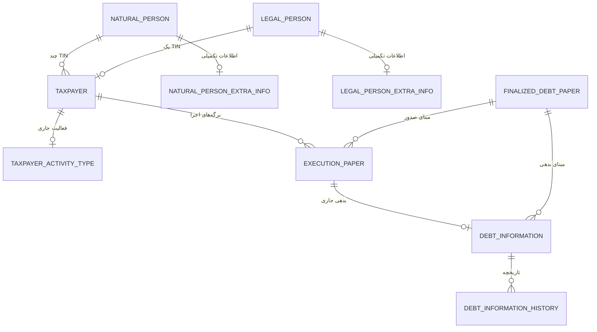

# مدل و مسیر دریافت EF03

این پیاده‌سازی بر اساس «مدل داده.docx»، مستند شناخت EF03، تب `LTR_EF03` اکسل و تصمیم‌های کاربر در `ef03-implementation-decisions.fa.md` است.

## استفاده

1. در مدیریت سامانه، «دریافت EF03» (`/admin/ef03-receipts`) را باز کنید.
2. شناسه درخواست، کد رهگیری ثبت‌نام، کد اداره سنیم و فایل XML را وارد کنید. سال، شناسه ملی و دوره از XML خوانده می‌شوند.
3. برای شخصی که هنوز پاسخ هویت ندارد، درخواست ذخیره می‌شود و پاسخ HTTP 202 برمی‌گردد. در این مرحله برگه و شماره‌ای صادر نشده است.
4. در «شبیه‌ساز تأیید هویت» (`/admin/identity-verifications`) نام/نام خانوادگی یا نام شرکت تأییدشده را ثبت کنید. پاسخ منفی با علت، درخواست را رد می‌کند؛ پاسخ مثبت صدور همان درخواست را ادامه می‌دهد.
5. برگه صادرشده شماره‌ای مانند `14050000001` و تاریخ صدور مستقل دارد. نبود واحد سازمانی، شروع گردش کار بعدی را در انتظار نگه می‌دارد؛ ثبت شماره و تاریخ، صدور محسوب می‌شود.
6. ادارات کل، امور و واحدها از `/admin/organizations` مدیریت می‌شوند. نوع اداره امور، مالیاتی (۰) یا اجرائیات (۱) است. تطبیق ادارهٔ دریافتی ابتدا با کد و در نبود کد ثبت‌شده، با نام اداره و اداره کل انجام می‌شود.

## API

- `POST /api/v1/debt-papers/push`: قرارداد ورودی سنیم با احراز هویت اختصاصی موجود. `followCode` الزامی است. نام قالب `LTR_EF03` یا `EF03` پذیرفته می‌شود. پاسخ 202 یعنی انتظار هویت؛ پاسخ 200 همراه شناسه برگ یعنی صدور.
- `POST /api/v1/admin/ef03/receive`: دریافت از پنل ادمین با فیلدهای `xml`, `referenceId`, `followCode`, `taxOfficeCode`, `taxSource`.
- `GET /api/v1/admin/identity-verifications`: آخرین درخواست‌ها و وضعیت آن‌ها.
- `POST /api/v1/admin/identity-verifications/{id}/decision`: پاسخ شبیه‌ساز با `verified` و اطلاعات هویتی یا `reason`.
- مسیرهای ادمین، مجوز `USER_PROFILE_ASSIGN_ORGANIZATION` می‌خواهند.

## موجودیت‌ها



- `Taxpayer`: کلید داخلی، TIN یکتا، کد رهگیری ثبت‌نام یکتا و دقیقاً یکی از ارتباط‌های شخص حقیقی/حقوقی. اطلاعات شماره و تاریخ برگه از این جدول حذف شده‌اند. ارتباط شخص حقوقی یکتا و ارتباط شخص حقیقی چندتایی است.
- `NaturalPerson` / `LegalPerson`: شناسه هویتی ثابت. نام و مشخصات قابل تغییر به جداول `*ExtraInfo` منتقل شده‌اند؛ جداول `*ExtraInfoHistory` نسخه قبلی تغییرات کسب‌وکاری را نگه می‌دارند.
- `TaxpayerActivityType`: فعالیت جاری مؤدی و تاریخچه تغییر عنوان در `TaxpayerActivityTypeHistory`.
- `ContactInfo`: اطلاعات تماس جاری؛ تغییر تلفن، نشانی و کدپستی در `ContactInfoHistory` ذخیره می‌شود.
- `FinalizedDebtPaper`: هم برگ قطعی و هم اظهارنامه. `debtPaperUniqueCode` شماره مبنا از N، `basisIssueDate` تاریخ مبنا از O، و `finalizationReason` نوع مبنا از M است. شماره و تاریخ نامهٔ سنیم F/G مستقل در `sourceDocument` باقی می‌مانند.
- `ExecutionPaper`: شماره جدید، تاریخ جدید، مبنای صدور، مؤدی و روابط سازمانی. وضعیت جاری گردش کار و تاریخچه وضعیت از شماره و تاریخ صدور مستقل‌اند.
- `DebtInformation`: مبالغ جاری، جزئیات هر دسته و ارتباط با برگه اجرا و مبنای بدهی. هر برگه یک رکورد بدهی جاری دارد. قبل از اعمال استعلام جدید، وضعیت قبلی در `DebtInformationHistory` ثبت می‌شود.
- `DebtPaperPushRecord`: XML خام، پوشش دریافتی، شناسه درخواست صدور، وضعیت انتظار/رد/صدور و علت خطا.
- `ExecutionPaperIssuanceRequest`: دادهٔ درخواست، XML، هش، وضعیت هویت و علت رد.
- `FakeIdentityVerification`: پاسخ ماندگار شبیه‌ساز برای شناسه شخص. استنباط نوع شخص از طول شناسه فقط برای هدایت استعلام است و تأیید هویت محسوب نمی‌شود.

## سال و دوره

`source_tax_year` از C، `source_tax_period_start_raw` از D و `source_tax_period_end_raw` از E ذخیره می‌شوند. مقدار دوره تسلیم برای EF03 سالانه و یک است. سال پوشش API به‌عنوان دادهٔ خام دریافت حفظ می‌شود و جایگزین سال XML نمی‌شود. تاریخ‌های منبع با متن اصلی حفظ می‌شوند.

## مجموع‌ها و جزئیات مستقل

مجموع‌ها در ستون‌های جدا ذخیره می‌شوند؛ `@Embedded` در Java به معنی ادغام در یک ستون نیست.

| مفهوم | تگ EF03 | ستون مجموع در `debt_information` | ستون جزئیات JSON |
|---|---|---|---|
| مالیات | CB | `aggregate_total_tax_amount` | `tax_liability_details` |
| اعتبار | ارسال نمی‌شود؛ صفر | `aggregate_total_credit_amount` | `tax_credit_details` |
| جرائم | GB، با کنترل برابری NB | `aggregate_total_penalty_amount` | `total_penalties_details` |
| پرداختی | EB | `aggregate_total_paid_amount` | `total_payments_details` |
| بخشودگی/معافیت | DB | `aggregate_total_remission_amount` | `total_remissions_details` |
| مانده | HB | `aggregate_outstanding_debt_amount` | `outstanding_debt_details` |

مبالغ اولیه و جزئیات اولیه نیز همراه سند مبنا حفظ می‌شوند. جزئیات جرائم، تمام رخدادهای KB/MB را با ترتیب و تکرار اصلی نگه می‌دارند؛ رکوردهای تکراری حذف نمی‌شوند و مجموع جرائم از جمع این ردیف‌ها بازسازی نمی‌شود. مبنا GB است و اختلاف آن با NB خطای `DATA_INCONSISTENCY` می‌دهد. مانده HB نیز با فرمول مستند شناخت (مالیات + جرائم − اعتبار − پرداختی − بخشودگی) کنترل می‌شود؛ اعتبار EF03 در ورودی فعلی صفر است. جزئیات اعتبارِ ارسال‌نشده آرایه خالی است. تگ مالی غایب صفر است؛ مقدار عددی نامعتبر یا تگ مجموع مبهم، خطاست.

مبالغ اعشاری نمونه بدون گرد کردن با `BigDecimal` و ستون TEXT دقیق در SQLite ذخیره می‌شوند. هنگام استعلامی که فقط مجموع جدید می‌آورد، جزئیات قدیمی دستهٔ تغییرکرده به‌عنوان جزئیات جاری نمایش داده نمی‌شوند؛ نسخهٔ اولیه و تاریخچه محفوظ‌اند.

## شماره‌گذاری و تراکنش

شمارنده در `execution_number_sequence` به تفکیک سال شمسی زمان صدور نگه داشته می‌شود. تخصیص شماره و درج برگه در یک تراکنش انجام می‌شوند. قفل نوشتن دیتابیس پیش از خواندن وضعیت صدور گرفته می‌شود؛ این حفاظت به یک پردازش Java محدود نیست. ستون شماره برگه قید یکتایی دارد. شمارنده از ۱ آغاز می‌شود و پس از ۹٬۹۹۹٬۹۹۹ خطا می‌دهد. تراکنش برگشت‌خورده شماره‌ای مصرف نمی‌کند. سال شماره و تاریخ برگه از یک زمان صدور گرفته می‌شوند.

## پایگاه داده و راه‌اندازی

پایگاه پیش‌فرض جدید `ef03.sqlite` است؛ با `DB_PATH` می‌توان مسیر را تعیین کرد. طرح جداول با نگاشت Hibernate در شروع برنامه ساخته می‌شود. پایگاه خالی محلی ساخته شده و نسخهٔ SQL قابل مرور در `ef03-schema.sql` قرار دارد. `RelationalSqliteDialect` کلیدهای خارجی را داخل CREATE TABLE ایجاد می‌کند و تمام اتصال‌های برنامه اجرای آن‌ها را فعال می‌کنند. داده‌های دمو فقط با `app.demo.enabled=true` فعال می‌شوند. نگهداری و مهاجرت داده‌های آزمایشی قدیمی طبق تصمیم کاربر لازم نیست؛ برای این نسخه از پایگاه جدید استفاده شود.

کنترل مهلت صدور و طراحی سیاست جدید تکرار/اصلاحیه، طبق تصمیم کاربر برای مرحله بعد هستند. چاپ، امکان پس از صدور است و نمونه PDF موجود مرجع طراحی آن است.

## آزمون

- مسیر واقعی SQLite: دریافت، انتظار هویت، پاسخ مثبت/منفی، شماره و تاریخ جدید، نگاشت مبنای خوداظهاری، مبالغ و جزئیات، چند TIN حقیقی و محدودیت TIN حقوقی.
- همزمانی: دو نمونهٔ تخصیص‌دهنده، ۴۰ درخواست، ادامه پس از بازگشایی دیتابیس، rollback و سقف ظرفیت؛ دو پاسخ همزمان برای یک درخواست صدور.
- نگاشت نمونه `executionPaperTest2.xml`: حفظ اعشار و چهار ردیف تکراری جرائم.
- راه‌اندازی مجدد: حفظ علت قطعیت جدید در اجرای مهاجرت‌های پیشین؛ بررسی کلیدهای خارجی واقعی و رد ارجاع به مؤدی ناموجود در SQLite.
- API: پاسخ 202 پیش از تأیید و رد کد رهگیری ثبت‌نام غایب.

فرمان‌ها:

```sh
mvn -o -Dskip.npm=true -Dskip.installnodenpm=true test
cd src/main/frontend
npm run build
```

### نتیجهٔ بررسی این تغییر

- پایگاه محلی خالی: ۴۱ جدول؛ `integrity_check = ok` و بدون نقض کلید خارجی.
- ساخت نهایی فرانت موفق است و هر دو مسیر دریافت EF03 و پاسخ هویت در خروجی ساخت حضور دارند.
- آخرین اجرای تست‌های نگاشت، تراکنش دریافت، مسیر کامل EF03 و شماره‌گذاری: ۱۵ تست موفق، بدون شکست. چهار تست API دریافت نیز موفق‌اند.
- اجرای کامل پیش از افزودن آخرین تست ناسازگاری مانده: ۱۱۲ تست، ۱۱۱ موفق و یک شکست در `TaskAuthorizationServiceTest.adminCanAssignAndViewAnyTask`. این تست انتظار اجازهٔ تخصیص برای ادمین دارد، در حالی که پیاده‌سازی موجود `canAssign` ادمین را از این عملیات منع می‌کند. فایل سرویس و تست مجوز در این تغییر دست‌نخورده‌اند.
- اتصال زنده به سنیم، ثبت احوال و گردش ابلاغ در این بررسی استفاده نشده است؛ تأیید هویت طبق تصمیم کاربر با شبیه‌ساز انجام می‌شود.

### ورود XML از صفحه دریافت

در `/admin/ef03-receipts` محتوای XML کپی می‌شود. `followCode` فیلد مستقل بدنهٔ درخواست است و از XML استخراج نمی‌شود. کد اداره در API این صفحه اختیاری است: عدد موجود در نام اداره (تگ `I`) با تبدیل ارقام فارسی/عربی استخراج می‌شود. اگر نام اداره عدد نداشته باشد یا چند عدد متفاوت داشته باشد، ورود دستی کد لازم است. کد دستی مغایر با کد یکتای موجود در نام اداره رد می‌شود. قرارداد API اصلی دریافت تغییر نکرده است.
