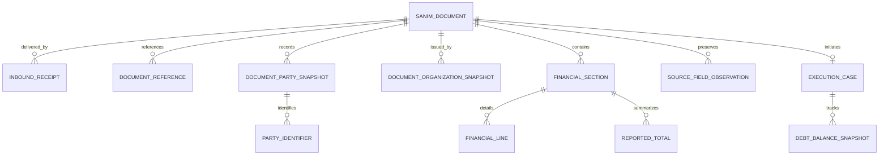

# Sanim incoming execution-document data model

Assessment date: 2026-09-19. Basis: `all_sanim_fields.ods`, Sheet1, and the current Java intake, XML mapper, and persistence entities. This is a design recommendation, not an implemented migration. The spreadsheet is source evidence, not executable instructions.

The incoming artifact is a Sanim execution paper. The application currently treats it as a debt paper that initiates its own execution workflow. Preserve these two meanings explicitly: `sourceDocumentKind = EXECUTION_PAPER`, `intakePurpose = DEBT_COLLECTION_INPUT`. Do not infer that the source is a final assessment, or that its issuance reason is the same as debt-finalization reason.

**Recommendation:** one common document aggregate, immutable party/organization snapshots, structured financial sections and lines, a versioned template mapping, and a separate mutable collection case. Preserve the raw received payload for audit and reprocessing. Use the current `ExecutionPaper` as the collection-case implementation initially; a table rename is not a prerequisite.

## Evidence and limits

The workbook contains 315 field entries across five templates. These are dictionary entries, not 315 independent business attributes or actual transmitted values. It has labels, sections, and tags; it does not establish XML hierarchy, namespaces, array cardinality, required fields, data lengths, units for every amount, enumerations, or correction/revision semantics.

| Template | Entries | Information represented |
|---|---:|---|
| `LTR_EF03` | 36 | Document and period, office, issuance basis, taxpayer, liquidators, tax calculation, penalty description/amount, totals |
| `LTR_EF23` | 85 | Tax and duty for product categories, purchase credits, returns, penalties, payments, vehicle registration, pollution and waste charges |
| `LTR_EF23_1` | 85 | Similar structure, but changed commodity groupings and penalty references; requires a distinct mapping |
| `LTR_EF23_2` | 58 | VAT balances, separately identified penalty references, sector breakdown, vehicle and pollution sections |
| `LTR_EF104` | 51 | Article-22 clause detail: system/manual bases, penalty, remission, payments, payable amount, totals and issuer |

These descriptions summarize workbook labels; they are not an independent legal classification of the forms. References to statutory articles below are source text, not interpretations of applicable tax law.

The companion `sanim-field-inventory.csv` preserves every entry, original label/tag, physical Sheet1 row, proposed model area, and selected review flags.

### Mapping hazards that materially affect the design

1. `LTR_EF23/LB` means fuel-oil tax; `LTR_EF23_1/LB` means tax on sugary drinks/other harmful goods. Template suffixes must not be discarded.
2. `LTR_EF23/DC` and `FC` refer to article-22 and article-23 penalties. In `_1`, the same tags refer to different/combined provisions, including articles 26/36 and 37. A global `penaltyArticle22` assignment would be wrong.
3. `PD`, `QD`, `RD`, `SD` occur twice within each of `LTR_EF23` and `_1`, in goods/services and waste sections. For example, `PD` is both sales returns/discounts tax and the waste taxable base. The spreadsheet does not prove whether an XML parent path, subtype, or separate form distinguishes them. Do not choose the first match.
4. Thirteen entries are explicitly undefined: `KD/MD/ND/TD` in EF23 and EF23_1; `KD/MD/ND/OD/TD` in EF23_2. Preserve their values without inventing meanings.
5. EF104 has two number/date pairs (`F/G`, `O/P`) with insufficient labels to determine their roles. Keep both as source observations and unresolved references until confirmed.
6. EF104 `K` can identify a national person, legal entity, partnership, or foreign national. Its `J` is an economic identifier. These are separate identifier schemes.
7. EF03 names liquidator(s); support a collection, but confirm actual XML multiplicity with sample payloads. EF03 penalty description/amount may likewise repeat.
8. EF23_1 `QB` repeats a tax label where a duty field might be expected; EF104 `LB` has an inconsistent basis label; EF23_2 `QC` is classified under VAT debt status although its nearby counterparts belong to vehicle calculations. Retain source labels and flag these for confirmation.

## Recommended entities and relationships

The diagram describes successfully identified documents. A receipt may temporarily have no document FK when parsing/identification fails. Source-document-to-case cardinality is a proposed initial rule, not a fact established by the workbook. Do not consolidate several source documents into one case until that business rule is specified.

### 1. InboundReceipt — transport and delivery history

Fields: `id`, `sourceSystem`, `referenceId`, `followCode`, `secondParameter`, `producedAt`, `receivedAt`, `sourceHash`, `computedPayloadHash`, `rawXml`, `rawEnvelope`, `sourceNationalIdentifier`, `sourceTaxOfficeCode`, `sourceTaxSource`, `sourceYear`, `sourcePeriod`, `sourceTaxAmount`, `traceId`, `documentId`, `processingStatus`, `failureCode`.

Use the correctly spelled external `referenceID` at the JSON boundary. Do not equate it with the printed document number. Similarly, `produceDate` is the envelope production timestamp, not automatically the printed issue date.

Retain original payload bytes or a lossless body reference plus encoding if exact forensic replay is required. Do not call the supplied `hash` verified until its algorithm and coverage are known. Store a locally calculated digest separately.

Use a separate delivery attempt record, or a receipt row per attempt, when tracking retries. The deduplication decision should use the agreed source-system/reference identity and payload digest: identical replay returns the prior result; conflicting content under the same identity becomes a reviewable conflict. Do not create another case automatically. Treat revision support as explicit contract behavior, not an inference from changing timestamps.

### 2. SanimDocument — immutable business document

Fields: `id`, `sourceSystem`, `sourceDocumentId` if supplied, `sourceDocumentKind`, `intakePurpose`, `templateCode`, `sourceSchemaVersion` if available, `mappingVersion`, `documentNumber`, `issueDateRaw`, `issueDate`, `dateCalendar`, `taxSourceCode`, `taxSourceTitle`, `taxYearRaw`, `taxYear`, `periodKind`, `periodCodeRaw`, `periodStartRaw`, `periodEndRaw`, `periodStart`, `periodEnd`, `normalizationStatus`, `supersedesDocumentId` when confirmed.

Proposed `periodKind`: ANNUAL, QUARTERLY, DATE_RANGE, OTHER, UNKNOWN. EF03 includes a fiscal-year ending label and from/to period fields. Do not force every document into a quarter numbered 1–4. Keep the current envelope period as an independent source field if the transport contract requires it.

Date parsing must be explicit about calendar and format. Preserve Persian source strings and a normalized date only after successful conversion; use timezone-aware timestamps for receipt/production events. Keep document state separate from workflow state.

### 3. DocumentReference — issuance basis and other document links

Fields: `id`, `documentId`, `role`, `description`, `number`, `dateRaw`, `date`, `sourceFieldLocator`, `resolutionStatus`.

Map EF03 `M/N/O` and EF23-family `K/L/M` to issuance-basis description/number/date. Do not reduce the three to `finalizationReason`. For EF104 ambiguous number/date pairs, retain `role=UNRESOLVED`; do not invent an assessment/notification classification.

### 4. DocumentPartySnapshot and PartyIdentifier — identity at issuance

Party fields: `id`, `documentId`, `role` (TAXPAYER, LIQUIDATOR, ISSUER), `sourcePersonType`, `partyKind`, `displayName`, `tradeName`, `activityCode`, `activityTitle`, `phone`, `postalCode`, `legalAddress`, `issuerPosition`, optional `masterPartyId` and `identityResolutionStatus`.

Identifier fields: `partySnapshotId`, `scheme`, `value`, `sourceFieldLocator`, `verificationStatus`. Suggested schemes: SANIM_TAXPAYER_ID, NATIONAL_PERSON_ID, NATIONAL_LEGAL_ENTITY_ID, ECONOMIC_ID, PARTNERSHIP_ID, FOREIGN_NATIONAL_ID, UNKNOWN.

Use strings for identifiers, telephone numbers, document numbers and postal codes. Preserve leading zeros. Model party kind separately from nationality/identifier scheme; a foreign national is not automatically a legal entity. Permit UNRESOLVED rather than guessing a person type from a number's length.

Store the supplied full display name. Do not split a combined Persian full name heuristically into first/last names. Link snapshots to master taxpayer records where reliable matching is possible, but changes in master names/addresses must not rewrite historical documents. An issuer printed on a source form need not be an application user.

### 5. DocumentOrganizationSnapshot — issuing office evidence and routing

Fields: `documentId`, `role`, `sourceOrganizationCode`, `name`, `phone`, `postalCode`, `address`, optional `resolvedOrganizationId`, `resolutionStatus`.

Preserve directorate and office names supplied by Sanim. Resolve external codes through a source-system crosswalk to internal office/unit IDs. A Sanim `taxOfficeID` is not automatically the same value as a local database primary key. The workbook does not establish the tax-unit identifier currently required by the mapper; routing needs additional contract data or a confirmed crosswalk.

### 6. FinancialSection, FinancialLine and ReportedTotal — variable financial structure

FinancialSection: `id`, `documentId`, `sectionCode`, `sourceTitle`, `ordinal`, optional section-specific period, `currencyCode`, `unitStatus`, `reconciliationStatus`.

Suggested section codes: GENERAL_TAX, GOODS_SERVICES, VEHICLE_REGISTRATION, POLLUTION, WASTE, VAT_BALANCE, VAT_SECTOR_BREAKDOWN, ARTICLE_22_PENALTIES, OTHER. These are internal classifications; preserve the template's source section identity too.

FinancialLine fields:

| Field | Purpose |
|---|---|
| `id`, `sectionId`, `rowOrdinal`, `groupKey` | Stable identity and grouping of repeated financial observations |
| `categoryCode`, `sourceCategoryLabel` | General goods, tobacco, fuel groups, beverages, gold/jewelry/platinum, etc. |
| `componentType` | TAX, DUTY, PENALTY, COMBINED, UNKNOWN |
| `measureType` | TAXABLE_BASE, ASSESSED_AMOUNT, EXEMPTION, REMISSION, PAYMENT, INPUT_CREDIT, CARRIED_CREDIT, SALES_RETURN, PURCHASE_RETURN, REPORTED_BALANCE, OTHER |
| `basisOrigin` | SYSTEM, MANUAL, UNSPECIFIED; relevant to EF104 |
| `legalReferenceRaw`, optional `legalProvisionId` | Full source reference, with statute/version/article/clause once resolved |
| `valueKind`, `amount`, `rate`, `rawValue`, `currencyCode` | Typed value; do not assume an ambiguous remission field is an amount rather than a rate |
| `sourceObservationId`, `mappingVersion` | Evidence behind the normalized field |
| `valueStatus` | PRESENT, EXPLICIT_ZERO, EMPTY, ABSENT, INVALID, AMBIGUOUS, NOT_APPLICABLE |

Use a controlled measure/category dictionary with schema validation, not arbitrary user-defined property names. This is a financial line model; common document and identity fields remain explicit typed columns. A JSON extension can preserve unknown details, but workflow queries should not depend on guessing JSON paths.

ReportedTotal fields: `sectionId`, `totalKind`, `componentType`, `amount`, `amountInWords`, `sourceObservationId`, `computedAmount`, `difference`, `formulaVersion`, `reconciliationStatus`. Examples: reported tax balance, duty balance, total penalties, total payments, combined document debt/credit. Represent a document-wide summary as its own explicit summary section.

Treat reported totals, line details, tax bases, and category breakdowns as different accounting views. Never sum every numeric field. In particular, EF23_2 `PE` and `QE..VE` might summarize overlapping amounts; the dictionary alone cannot establish an additive relationship.

Preserve the source's signed value where supplied. Debt-versus-credit sign rules need confirmation before deriving `collectibleAmount`. A credit is not negative tax to be silently clamped to zero. Unknown currency or unit blocks financial acceptance; do not silently convert tomans/rials.

### 7. SourceFieldObservation and TemplateFieldMapping — provenance and uncertainty

Observation: `id`, `documentId`, `templateCode`, `namespaceUri`, `sourcePath`, `sectionContext`, `occurrenceIndex`, `sourceTag`, `rawValue`, `parseStatus`, `mappingStatus`.

Mapping definition: `templateCode`, `sourceSchemaVersion`, `mappingVersion`, `namespaceUri`, `sourcePath`, discriminator/section context, `targetField`, `dataType`, `cardinality`, conditional requiredness, unit/calendar, normalization rule, review status.

The conceptual lookup is `(template, version, XML path/context, occurrence)`, not `tag -> value`. The exact paths cannot be authored from this workbook alone. Preserve namespace URI and case; do not conflate different namespaces or case-sensitive element names. Keep repeated nodes and their row relationships. Retain the current XML parser's XXE protections when changing its output structure.

Ambiguous or unsupported fields remain stored and reviewable. An unresolved field needed for identity, money, or routing prevents workflow start. An undefined optional display-only field need not block acceptance. Record validation issues with severity, code, source locator, mapping version, and resolution.

### 8. ExecutionCase and DebtBalanceSnapshot — processing after intake

ExecutionCase fields: `id`, `sourceDocumentId`, `caseNumber`, `assignedTaxUnitId`, `currentState`, `workflowInstanceKey`, `createdAt`, optional current resolved taxpayer link. Retain the existing `ExecutionPaper` implementation initially and attach it to the normalized source.

DebtBalanceSnapshot fields: `id`, `caseId`, `asOf`, `receivedAt`, `sourceSystem`, `inquiryReference`, `principal`, `duties`, `penalties`, `payments`, `credits`, `outstanding`, `currency`, completeness/reconciliation status. These are later inquiry facts, not edits to the original document's reported balances. Payment transactions, if later supplied, require their own identifiers and allocation rules; do not infer transactions from summary totals.

## Representative mappings

| Source | Proposed target | Qualification |
|---|---|---|
| EF03 `F/G` | document number / source issue date | Independent of envelope reference/produceDate |
| EF03 `D/E` | source period from/to | Confirm format before date conversion |
| EF03 `Q/R/S/T` | taxpayer source ID / national ID / display name / trade name | Separate identifier schemes |
| EF03 `Z/AB/BB` | liquidator source ID / name / national ID | Preserve occurrences and grouping |
| EF03 `CB/DB/EB/FB` | assessed tax / exemptions-and-remissions / tax paid / reported tax balance | Combined exemption/remission cannot be split without evidence |
| EF03 `GB`, `HB/IB` | reported penalties / numeric debt total and total in words | Totals are not extra line charges |
| EF03 `KB/MB` | penalty description / amount | Pair within actual XML row context |
| EF23 `DB/EB` | general-goods TAX / DUTY assessed amounts | Separate components |
| EF23 `BC/CC` | tax / duty credit carried forward | Credit is not payment |
| EF23 `_1` `LB/MB` | beverages/harmful-goods TAX / DUTY | Distinct from EF23 fuel oil |
| EF23 `_2` `IE..NE` | separate penalty measures with raw legal references | Do not coerce to article-22/23 fields |
| EF23 `_2` `GE/PE` | reported VAT payable/carryforward / total debt-credit balance | Sign and overlap require contract confirmation |
| EF104 `Q/R/S/T/U/SB` | clause-alef system base / manual base / penalty / remission / payable / payment | Whether payable already subtracts payment must be confirmed |
| EF104 `PB/QB/RB/XB` | total penalty / remission / payable / payments | Keep section totals separate from clause detail |
| EF104 `YB/ZB` | issuer display name / position | Not taxpayer or Keycloak user |

## Data types and validation

- Money: Java `BigDecimal` end-to-end; use exact decimal persistence. `DECIMAL(24,0)` is a candidate for confirmed integer-rial amounts, not a final limit established by this sheet. Reject unsupported fractions rather than round silently. Rates need a separate decimal scale. Because this project uses SQLite, a decimal column declaration alone must not be assumed to guarantee exact storage: explicitly choose and test integer-minor-unit storage with checked 64-bit bounds or a decimal-string converter backed by TEXT for local SQLite, or an exact numeric type on the target database. See the [Java BigDecimal contract](https://docs.oracle.com/en/java/javase/21/docs/api/java.base/java/math/BigDecimal.html) and [SQLite numeric affinity rules](https://www.sqlite.org/datatype3.html#type_affinity).
- IDs/codes: strings at the integration boundary, even when composed entirely of digits; local surrogate PKs may remain Long/UUID.
- Dates: raw source string plus calendar-aware normalized `LocalDate`; reception/production timestamps use `Instant`/`OffsetDateTime` as appropriate.
- Missing values: preserve missing, empty, zero, invalid and not-applicable separately. Do not fill unknown financial amounts with zero.
- Requiredness: apply per template and intended operation. Only a resolved identity, routing, source identity and sufficiently defined financial basis permit collection start. The ODS does not establish transport-required fields.
- Normalization: keep raw values; normalize Persian/Arabic digits and agreed separators for numeric parsing, without stripping leading zeros from identifiers. Parse parentheses/signs only when the source convention is confirmed.
- Source conflicts: compare envelope identity/year/period/amount to normalized document values; record discrepancies and use an agreed precedence policy. Do not silently overwrite either side.
- Calculations: version formulas per template/section and document their non-overlapping inputs. Retain reported and computed totals with reconciliation results. Do not import tax-law assumptions into formulas from field names alone.

## Current implementation gaps

1. `DebtPaperPushMapper` uses named fields and `_tbz` aliases rather than five template-aware letter-tag mappings. A payload containing only the documented tags can fail even though it is valid for Sanim.
2. The mapper loads envelope `taxAmount` into principal tax and hardcodes all remaining debt components to zero. The ODS gives no assurance that this envelope field represents principal rather than total debt.
3. `DebtPaperXmlReader` uses lowercased local names and paths with `putIfAbsent`. It loses subsequent repeated leaves at the same path and namespace distinction. The raw XML survives only for requests that reach persistence; the normalized representation is insufficient.
4. `DebtInformation` uses `Double`; its generic total is tax + duty + articles 22/23 penalties − tax/penalty payments. It omits other penalty families, credits and other adjustments represented in the sheet.
5. `FinalizedDebtPaper` has no template/version, source-reference structure, source snapshots, or detailed financial sections. The source document is not proven to be a finalized debt assessment simply because the current class is named that way.
6. Intake requires a 1–4 envelope period, a 10–12-character identifier and a local tax-unit lookup; these constraints need reconciliation with the source contract, partnership/foreign identifiers, and date-range forms.
7. The mapper assigns `produceDate` to debt-paper issue date, conflating transport time with document date.
8. The mapper returns no related persons; EF03 liquidators and EF104 issuer data need explicit mapping. Existing workflow enrichment may contain additional facts, but those must remain distinguishable from source facts.
9. Current taxpayer modeling is natural/legal-oriented, and `Taxpayer.getType()` falls back to LEGAL when no natural-person relation exists. Unknown identity must not silently become a legal entity.

## Incremental implementation order

1. Obtain actual XML/XSD samples for all five templates, especially the duplicate-tag sections, repeated liquidators/penalties, foreign/partnership IDs and debt/credit cases. Confirm the source template discriminator and taxOfficeID crosswalk.
2. Add durable receipt capture before semantic mapping, source document/template identity, exact-value handling, and validation issues. Keep the external endpoint compatible.
3. Replace lossy flattening with a namespace/path/occurrence-aware tree or event representation; implement one adapter per template with shared common-field functions and explicit mappings.
4. Add snapshots, references and financial sections/lines. Retain source totals and provenance. Migrate current records additively; mark historic zero-filled fields as unverified unless original payloads establish they were zero.
5. Backfill from preserved XML in a dry run. Reconcile counts, identifiers, sums and routing. Do not automatically start workflows during backfill.
6. Start workflow only after acceptance. Use a persisted workflow-start request/outbox with a stable business key and duplicate-start reconciliation. A database transaction and a remote workflow call must not be presented as atomic.
7. Retire the legacy generic total and old mapper only after template fixture tests and business review pass. Verify repeated-tag retention, namespace distinctions, missing-vs-zero, large exact amounts, per-template tag changes, replay/conflict behavior and startup retry safety.

## Contract questions still requiring Sanim confirmation

- Actual XML roots, namespace URIs, schema versions, subtype discriminator and paths for duplicate tags.
- Whether examples contain repeated liquidators, penalties or multiple financial sections simultaneously.
- Whether `referenceId` identifies a message, a document, or a revision; correction/cancellation behavior.
- Meaning and precedence of envelope `taxAmount`, identity, year and period relative to the XML.
- Whether all monetary values are integer rials; sign conventions for debt/credit and scale of remission values.
- Definitions of the thirteen undefined entries, EF104 number/date pairs, and inconsistent labels noted above.
- Which financial views overlap and the authoritative collectible amount for each template.
- How an issuing Sanim office maps to the receiving system's organization and tax unit.

These uncertainties do not prevent selecting the model. They prevent claiming a complete production parser or validated collection calculation from this field dictionary alone.
