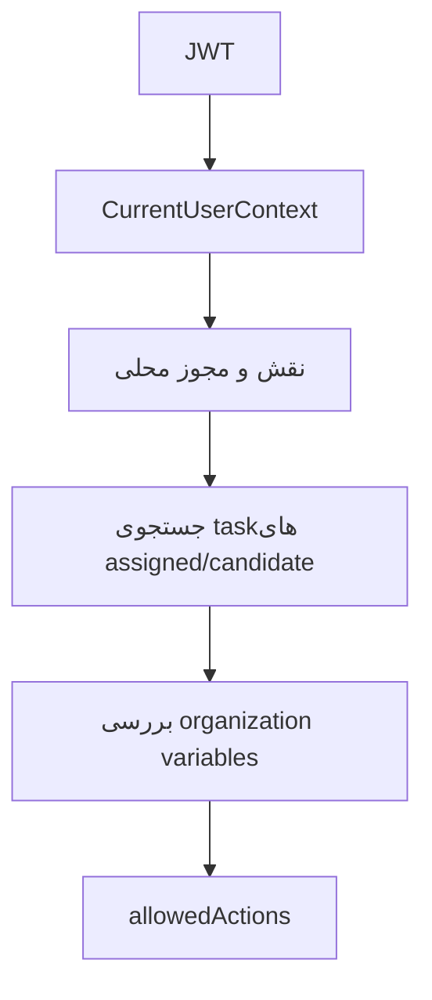

# معماری امنیت

Last Updated: 2026-07-15

## هدف سند

شرح معماری احراز هویت، مجوزدهی، نقش‌ها، scope سازمانی و مرزهای امنیتی.

## مخاطبان

تیم امنیت، معماران، توسعه‌دهندگان.

## احراز هویت

Keycloak مسئول login و صدور JWT است. Spring Boot با `spring-boot-starter-oauth2-resource-server` و `issuer-uri`، token را اعتبارسنجی می‌کند. frontend با `keycloak.js` code را به token تبدیل و در APIهای بعدی Bearer token ارسال می‌کند.

## مجوزدهی

| لایه | سازوکار |
|---|---|
| Spring endpoint | `@PreAuthorize` و `SecurityConfig` |
| Authority extraction | `KeycloakJwtAuthenticationConverter` |
| Local permission | `GroupPermissionRepository` و `SecurityIdentityService` |
| Task authorization | `TaskAuthorizationService` |
| Organization scope | `OrganizationScopeService` |
| Frontend visibility | `navigation.js` |

## جریان امنیتی task

## مرزهای اعتماد

- Keycloak منبع هویت است.
- پایگاه داده برنامه منبع پروفایل محلی، نقش کسب‌وکاری، مجوز و سازمان است.
- Camunda منبع task فعال است.
- fake services فقط برای توسعه/دمو هستند.

## ریسک‌های مهم

- مقدار secret واقعی در config پیش‌فرض دیده شد.
- `/api/v1/dashboard/stats` در `SecurityConfig` permitAll شده است.
- sync کاربران Keycloak با service account نیازمند roleهای مدیریتی حساس است.
- CORS با default config مشخصاً محدود نشده است.

## اسناد مرتبط

- [امنیت فنی](../technical/security.md)
- [ریسک‌های امنیتی](../analysis/security-risks.md)

## سوالات باز

- سیاست نگهداری token در frontend برای production چیست؟
- آیا endpointهای fake باید فقط در profile dev فعال باشند؟

