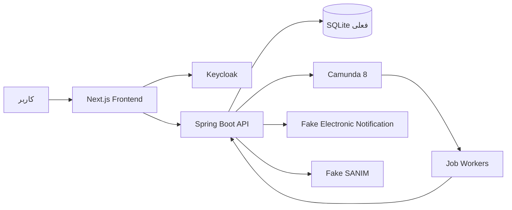
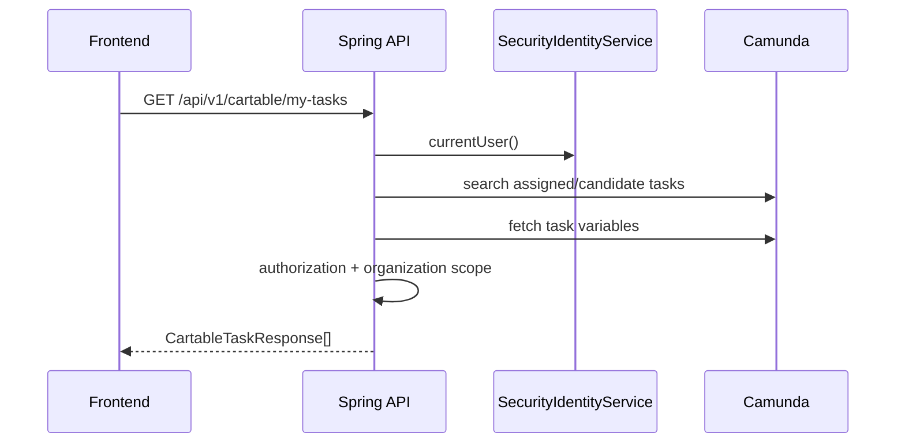
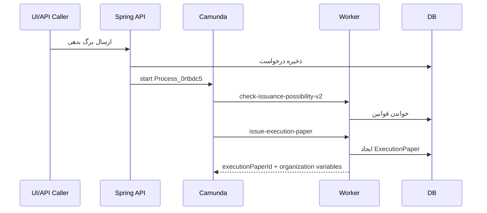

# معماری سیستم

Last Updated: 2026-07-15

## هدف سند

توضیح نمای کلان سامانه، مرزهای مؤلفه‌ها، جریان داده، احراز هویت و topology منطقی.

## مخاطبان

معماران، توسعه‌دهندگان ارشد، DevOps و تیم امنیت.

## نمای کلان

## مؤلفه‌ها

| مؤلفه | مسئولیت | شواهد |
|---|---|---|
| Frontend | UI فارسی، login، cartable، admin، reports | `src/main/frontend/src/app` |
| Backend API | REST، امنیت، domain logic، DTO | `presentation/api`, `application/service` |
| Domain/Persistence | entityها و repositoryها | `domain/model`, `domain/repository` |
| Camunda | workflow، user task، job worker | `bpmn`, `infrastructure/camunda` |
| Keycloak | احراز هویت و نقش پایه | `SecurityConfig`, `keycloak.js` |
| Fake integrations | شبیه‌سازی ابلاغ و سنیم | `FakeElectronicNotificationService`, `FakeSanimInformService` |

## جریان درخواست کارتابل

## جریان صدور برگ اجرا

## لایه‌ها

- Presentation: کنترلرهای REST.
- Application: سرویس‌ها، DTO، security context، rule engine.
- Domain: entity، enum، repository.
- Infrastructure: Camunda client, workers, message publisher.
- Frontend: Next.js app router، components، API clients.

## اسناد مرتبط

- [معماری بک‌اند](backend-architecture.md)
- [معماری فرانت‌اند](frontend-architecture.md)
- [معماری گردش‌کار](workflow-architecture.md)
- [معماری امنیت](security-architecture.md)

## سوالات باز

- topology تولیدی شامل reverse proxy، TLS، database و Camunda cluster در ریپازیتوری مشخص نیست.
