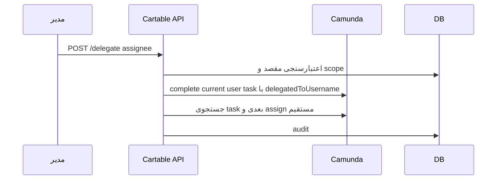

# معماری گردش‌کار

Last Updated: 2026-07-15

## هدف سند

شرح یکپارچه‌سازی Camunda 8، processها، job workerها، user taskها و ارتباط داده کسب‌وکاری با process variables.

## مخاطبان

معمار workflow، توسعه‌دهندگان بک‌اند، QA.

## فرایندهای BPMN

| فایل | Process ID | نام | هدف |
|---|---|---|---|
| `ExecutionPapers.bpmn` | `Process_0rtbdc5` | `ExecutionPapers` | صدور و گردش سازمانی برگ اجرا |
| `Inform.bpmn` | `Process_0lt64q4` | `NoticeProcess` | ابلاغ و ارسال تاریخ ابلاغ |

## الگوی integration

- شروع فرایند با `CamundaProcessService.startExecutionPaperIssuanceProcess`.
- job workers با annotation `@JobWorker`.
- user tasks از Camunda 8 User Task API خوانده/claim/complete/assign می‌شوند.
- متغیرهای مهم در `ProcessConstants` تعریف شده‌اند.
- taskهای انسانی از BPMN candidateGroups و local authorization عبور می‌کنند.

## توالی نمونه delegation

## مدیریت خطا

Workerها معمولاً در catch، fail command به Camunda می‌فرستند. برخی workerها باید در برابر متغیرهای ناقص مقاوم‌تر شوند؛ نمونه اخیر `CheckInformPossibilityWorker` برای نبود `executionPaperId` پیام خطای روشن تولید می‌کند.

## اسناد مرتبط

- [فرایند برگ اجرا](../workflow/processes/execution-paper-process.md)
- [فرایند ابلاغ](../workflow/processes/inform-process.md)
- [بک‌اند فنی](../technical/backend.md)

## سوالات باز

- retry policy در BPMN برای taskDefinitionها خالی/نامشخص است.
- نسخه‌دهی BPMN و migration process instanceها تعریف نشده است.

