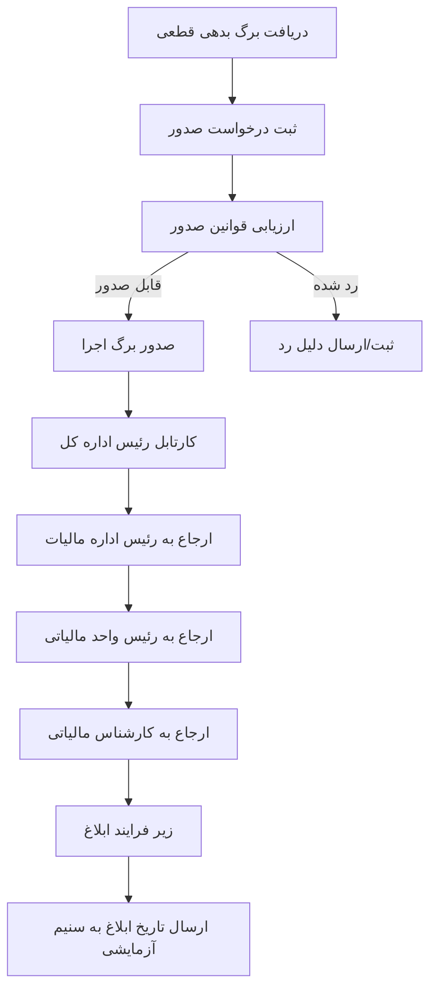

# فرایندهای کسب‌وکار

Last Updated: 2026-07-15

## هدف سند

شرح چرخه عمر برگ اجرا از دریافت برگ بدهی تا صدور، ارجاع، ابلاغ و پیگیری.

## مخاطبان

تحلیلگران، مدیران فرایند، تیم توسعه و تست.

## چرخه اصلی برگ اجرا

## فرایند صدور

| بخش | توضیح |
|---|---|
| Trigger | `POST /api/v1/debt-papers/issue` یا `POST /api/v1/admin/data-entry/finalized-debt-papers/send` |
| Actors | سامانه عملیاتی/ادمین |
| Preconditions | payload معتبر برگ بدهی قطعی |
| Main flow | ذخیره درخواست، شروع Camunda، بررسی قوانین، صدور برگ اجرا |
| Alternative | رد به دلیل rule engine |
| Output | `ExecutionPaper`, متغیرهای Camunda شامل `executionPaperId`, `executionPaperCode`, متغیرهای سازمانی |
| Related BPMN | `src/main/resources/bpmn/ExecutionPapers.bpmn` |
| Related APIs | `IssuanceController`, `AdminDataEntryController` |

## فرایند ارجاع سازمانی

| مرحله | Actor | task BPMN | شرط تکمیل |
|---|---|---|---|
| اداره کل | `GENERAL_OFFICE_HEAD` | `Activity_0generalHeadReview` | delegate به `TAX_OFFICE_HEAD` مرتبط |
| اداره مالیات | `TAX_OFFICE_HEAD` | `Activity_0taxOfficeHeadReview` | delegate به `TAX_UNIT_HEAD` مرتبط |
| واحد مالیاتی | `TAX_UNIT_HEAD` | `Activity_0taxUnitHeadReview` | delegate به `TAX_EXPERT` مرتبط |
| کارشناس | `TAX_EXPERT` | `Activity_0taxExpertProcess` | complete یا رسیدگی عملیاتی |

## فرایند ابلاغ

| بخش | توضیح |
|---|---|
| Trigger | call activity از فرایند برگ اجرا |
| تصمیم | `check-inform-possibility` |
| مسیر موفق | ارسال به fake electronic notification، دریافت message `ExecutionPaperInformed`، ثبت تاریخ ابلاغ، ارسال به fake SANIM |
| مسیر رد | ثبت رد ابلاغ، تنظیم `reInformDate`، انتظار timer، بررسی دوباره |
| Related BPMN | `src/main/resources/bpmn/Inform.bpmn` |

## جریان‌های استثنایی

- درخواست تکراری: `DUPLICATE_REQUEST`.
- task خارج از محدوده سازمانی: `UNAUTHORIZED_TASK_ACCESS`.
- ارجاع به کاربر خارج از نقش/سازمان: `DELEGATION_TARGET_NOT_ALLOWED`.
- خطای Camunda: `PROCESS_START_FAILED`, `TASK_COMPLETION_FAILED`.
- نبود متغیر process مثل `executionPaperId`: خطای worker و fail command.

## اسناد مرتبط

- [قوانین کسب‌وکار](business-rules.md)
- [معماری گردش‌کار](../architecture/workflow-architecture.md)
- [API](../technical/api.md)

## سوالات باز

- تعریف نهایی «تکمیل رسیدگی کارشناس» چیست؟
- آیا لغو برگ اجرا فرایند مستقل دارد؟

