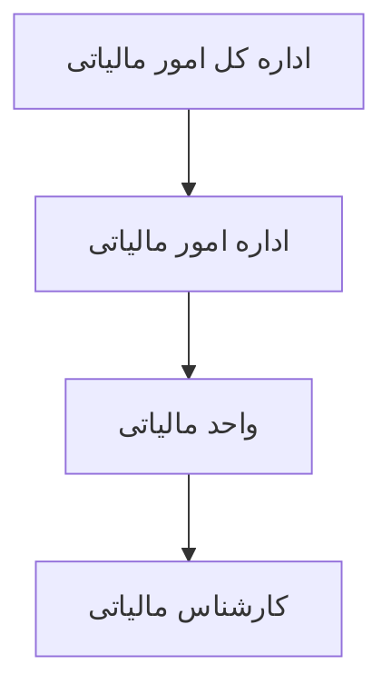

# سازمان و نقش‌ها

Last Updated: 2026-07-15

## هدف سند

توضیح سلسله‌مراتب سازمانی، نقش‌ها، مسئولیت‌ها، محدوده دسترسی و مسیرهای معتبر ارجاع.

## مخاطبان

مدیران کسب‌وکار، تحلیلگران، تیم امنیت و تیم توسعه.

## سلسله‌مراتب سازمانی

## موجودیت‌های سازمانی

| سطح | Entity | جدول | مسیر |
|---|---|---|---|
| اداره کل امور مالیاتی | `GeneralDirectorateOfTaxAffairs` | `general_directorate_of_tax_affairs` | `src/main/java/.../masterdata/GeneralDirectorateOfTaxAffairs.java` |
| اداره مالیات | `TaxAffairsOffice` | `tax_affairs_office` | `src/main/java/.../masterdata/TaxAffairsOffice.java` |
| واحد مالیاتی | `TaxUnit` | `tax_unit` | `src/main/java/.../masterdata/TaxUnit.java` |

## نقش‌ها

| نقش | مسئولیت کسب‌وکاری | مسیر فنی |
|---|---|---|
| `ADMIN` | مدیریت سامانه، کاربران، مجوزها، سازمان و تنظیمات | `BusinessRole`, `SecurityDataInitializer` |
| `GENERAL_OFFICE_HEAD` | مشاهده و ارجاع برگ اجرا در محدوده اداره کل | `CartableService.isInDelegationScope` |
| `TAX_OFFICE_HEAD` | ارجاع به رئیس واحد مالیاتی مرتبط | `BusinessRole.nextDelegationRole()` |
| `TAX_UNIT_HEAD` | ارجاع به کارشناس مالیاتی مرتبط | `TaskAuthorizationService.canDelegate` |
| `TAX_EXPERT` | رسیدگی عملیاتی؛ ارجاع بعدی ندارد | `BusinessRole` |

## سلسله‌مراتب ارجاع

## محدوده دسترسی سازمانی

| نقش | محدوده |
|---|---|
| `GENERAL_OFFICE_HEAD` | فقط taskهایی که متغیر `generalDirectorateId` آنها با پروفایل محلی کاربر برابر است. |
| `TAX_OFFICE_HEAD` | فقط taskهایی که `taxAffairsOfficeId` مرتبط دارند. |
| `TAX_UNIT_HEAD` و `TAX_EXPERT` | فقط taskهای مرتبط با `taxUnitId`. |
| `ADMIN` | مشاهده مدیریتی؛ inbox عملیاتی عادی ندارد. |

## مسیرهای ارجاع معتبر

| مبدا | مقصد معتبر | شرط |
|---|---|---|
| `GENERAL_OFFICE_HEAD` | `TAX_OFFICE_HEAD` | همان اداره کل |
| `TAX_OFFICE_HEAD` | `TAX_UNIT_HEAD` | همان اداره مالیات |
| `TAX_UNIT_HEAD` | `TAX_EXPERT` | همان واحد مالیاتی |

## سناریوهای نامعتبر

- ارجاع رئیس اداره کل تهران به رئیس اداره مالیات استان دیگر.
- ارجاع مستقیم `GENERAL_OFFICE_HEAD` به `TAX_EXPERT`.
- ارجاع توسط `TAX_EXPERT` در وضعیت فعلی.
- ارجاع task خارج از محدوده سازمانی.
- ارجاع taskی که به کاربر جاری assign نشده است.

## مسئولیت ADMIN

`ADMIN` مسئول مدیریت پیکربندی، کاربران، مجوزها و داده‌های پایه است. طبق رفتار فعلی، `/` و «داشبورد فرایندها» برای ADMIN در دسترس است و کاربران غیرادمین به `/tasks` هدایت می‌شوند.

## اسناد مرتبط

- [قوانین کسب‌وکار](business-rules.md)
- [معماری امنیت](../architecture/security-architecture.md)
- [امنیت فنی](../technical/security.md)

## سوالات باز

- آیا نقش‌های موقت یا جانشین سازمانی نیاز است؟
- آیا ارجاع بین استان‌ها با مجوز خاص باید پشتیبانی شود؟

