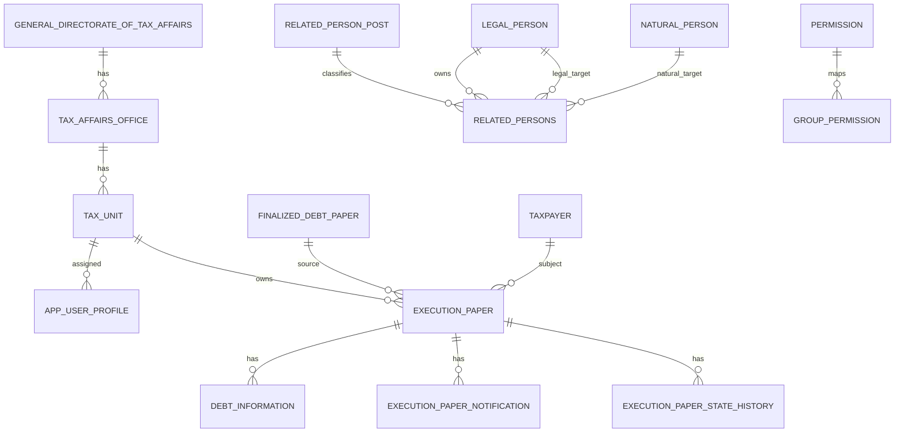

# پایگاه داده

Last Updated: 2026-07-15

## هدف سند

شرح entityها، روابط، ریسک‌های داده و وضعیت migration.

## مخاطبان

توسعه‌دهندگان بک‌اند، DBA، معماران.

## پیکربندی

پایگاه داده فعلی SQLite است: `spring.datasource.url=jdbc:sqlite:${DB_PATH:...}`. Hibernate با `ddl-auto=update` فعال است. اسکریپت‌های دستی محدود در `src/main/resources/db/manual` وجود دارد، اما Flyway/Liquibase یافت نشد.

## موجودیت‌های مهم

| Entity | Table | هدف | روابط مهم |
|---|---|---|---|
| `AppUserProfile` | `app_user_profile` | پروفایل کسب‌وکاری کاربر Keycloak | `TaxUnit`, `TaxAffairsOffice`, `GeneralDirectorateOfTaxAffairs` |
| `Permission` | `permission` | مجوز محلی | `GroupPermission` |
| `GroupPermission` | `group_permission` | نگاشت group/role به permission | `Permission` |
| `AuditLog` | `audit_log` | رخدادهای audit | مستقل |
| `GeneralDirectorateOfTaxAffairs` | `general_directorate_of_tax_affairs` | اداره کل | parent اداره مالیات |
| `TaxAffairsOffice` | `tax_affairs_office` | اداره مالیات | many-to-one اداره کل |
| `TaxUnit` | `tax_unit` | واحد مالیاتی | many-to-one اداره مالیات |
| `ExecutionPaper` | `execution_paper` | برگ اجرا | finalized debt, taxpayer, tax unit |
| `FinalizedDebtPaper` | `finalized_debt_paper` | برگ بدهی قطعی | اداره کل/اداره/واحد |
| `DebtInformation` | `debt_information` | مبالغ بدهی | execution paper |
| `ExecutionPaperNotification` | `execution_paper_notification` | وضعیت ابلاغ | execution paper |
| `ExecutionPaperStateHistory` | `execution_paper_state_history` | تاریخچه وضعیت | execution paper |
| `RelatedPerson` | `related_persons` | رابطه زمان‌دار اشخاص حقیقی/حقوقی با شخص حقوقی مودی | owner legal person, natural/legal target |
| `RelatedPersonPost` | `related_person_post` | جدول مرجع enum سمت اشخاص مرتبط | referenced by related persons |
| `FakeElectronicNotificationRequest` | `fake_electronic_notification_request` | fake ابلاغ | execution paper |
| `FakeSanimInformRequest` | `fake_sanim_inform_request` | fake سنیم | execution paper |

## ER ساده

## ریسک‌های داده

- `ddl-auto=update` برای production خطرناک است.
- بسیاری از روابط `LAZY` هستند؛ APIها باید DTO استفاده کنند.
- نبود migration رسمی برای schema کامل.
- SQLite برای حجم بالا/هم‌زمانی production مناسب نیست.
- تاریخ‌ها ترکیبی از `LocalDateTime`, String و `OffsetDateTime` هستند.

## اسناد مرتبط

- [بک‌اند](backend.md)
- [ریسک‌های امنیتی](../analysis/security-risks.md)

## سوالات باز

- پایگاه داده هدف production PostgreSQL است یا محصول دیگر؟
- استراتژی migration و indexگذاری چیست؟
