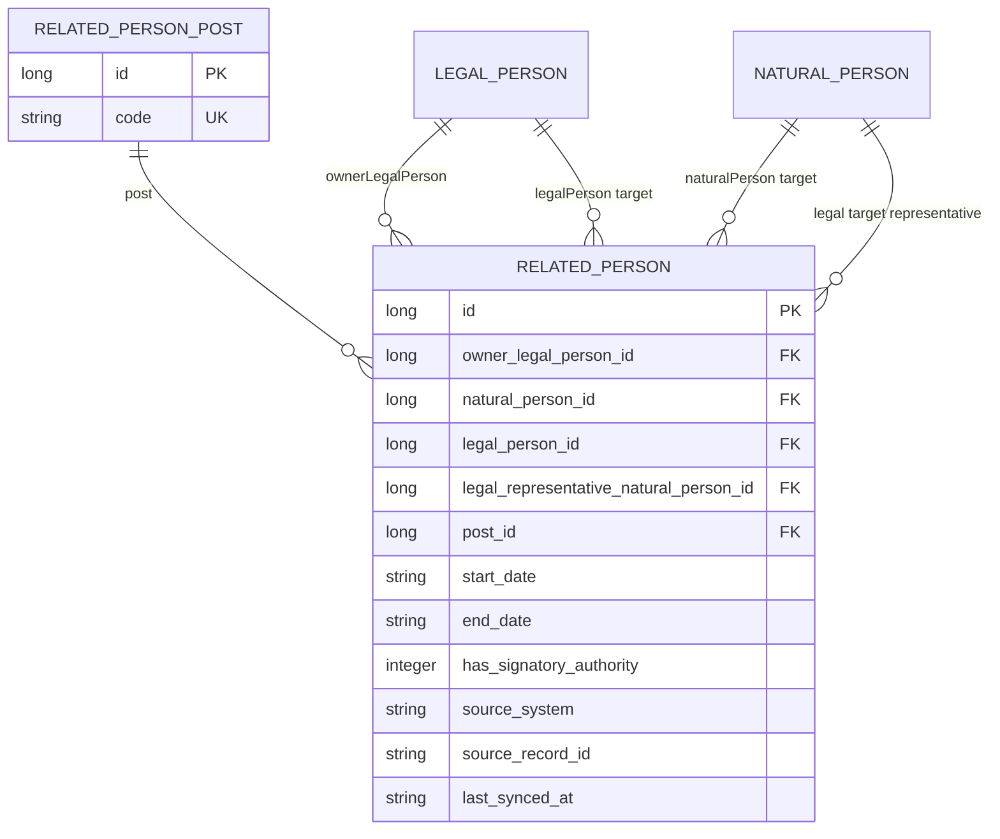

# رابطه اشخاص مرتبط

Last Updated: 2026-07-26

## هدف سند

این سند مدل داده، قواعد دامنه، API و فرایند همگام‌سازی «اشخاص مرتبط» با مودی حقوقی را شرح می‌دهد. پیاده‌سازی فعلی به سامانه ثبت شرکت‌های fake متصل است.

## تعریف رابطه

`RelatedPerson` خودِ شخص نیست؛ یک رابطه زمان‌دار میان یک شخص حقوقیِ مالک و دقیقاً یک شخص حقیقی یا حقوقیِ مرتبط است. بنابراین اطلاعات هویتی در `NaturalPerson` یا `LegalPerson` نگهداری می‌شود. سمت در جدول مرجع `RelatedPersonPost` و بازه اعتبار و حق امضا در `RelatedPerson` قرار می‌گیرد.



رابطه به شخص حقوقی مودی تعلق دارد و برای همه برگ‌های اجرای آن مودی قابل استفاده مجدد است. جدول رابطه ستون `execution_paper_id` ندارد؛ برگ اجرا فقط زمینه بازیابی و تعیین سال بدهی را فراهم می‌کند.

## قواعد دامنه

هر رابطه باید این شرایط را داشته باشد:

1. `ownerLegalPerson` الزامی است.
2. دقیقاً یکی از `naturalPerson` یا `legalPerson` باید مقدار داشته باشد.
3. `post` الزامی است و enum ذخیره‌شده در آن باید برای نوع شخص مقصد مجاز باشد.
4. اگر مقصد شخص حقوقی باشد، `legalRepresentativeNaturalPerson` الزامی و مرتبط با جدول `natural_person` است.
5. اگر مقصد شخص حقیقی باشد، `legalRepresentativeNaturalPerson` باید خالی باشد.
6. شخص حقیقی باید حداقل `nationalCode` یا `fida` داشته باشد.
7. شخص حقوقی مقصد باید حداقل `nationalId` یا `registrationNumber` داشته باشد.
8. تاریخ‌ها شمسی و با قالب متعارف `yyyy-MM-dd` نگهداری می‌شوند. ورودی ارقام فارسی به انگلیسی و `/` به `-` تبدیل می‌شود.

سه قاعده اول هنگام `persist/update` نیز با callback موجودیت کنترل می‌شوند.

## انواع شخص و سمت‌های مجاز

| کد سمت | عنوان | حقیقی | حقوقی |
|---|---|:---:|:---:|
| `CEO` | مدیرعامل | بله | خیر |
| `BOARD_CHAIR` | رئیس هیئت‌مدیره | بله | خیر |
| `BOARD_VICE_CHAIR` | نایب‌رئیس هیئت‌مدیره | بله | خیر |
| `BOARD_MEMBER` | عضو هیئت‌مدیره | بله | بله |
| `ALTERNATE_BOARD_MEMBER` | عضو علی‌البدل هیئت‌مدیره | بله | بله |
| `MANAGING_PARTNER` | شریک مدیر | بله | خیر |
| `PARTNER` | شریک | بله | بله |
| `SHAREHOLDER` | سهام‌دار | بله | بله |
| `LEGAL_REPRESENTATIVE` | نماینده قانونی | بله | بله |
| `LEGAL_ENTITY_REPRESENTATIVE` | نماینده شخص حقوقی | بله | خیر |
| `LIQUIDATOR` | مدیر تصفیه | بله | بله |
| `PRIMARY_INSPECTOR` | بازرس اصلی | بله | بله |
| `ALTERNATE_INSPECTOR` | بازرس علی‌البدل | بله | بله |
| `PARENT_COMPANY` | شرکت مادر | خیر | بله |
| `SUBSIDIARY` | شرکت تابعه | خیر | بله |
| `AFFILIATE` | شخص حقوقی وابسته | خیر | بله |

کد نوع شخص `NATURAL` برای شخص حقیقی و `LEGAL` برای شخص حقوقی است.

## بازیابی اشخاص مرتبط

```http
GET /api/v1/execution-papers/{id}/related-persons
```

مجوز لازم یکی از `REPORT_VIEW` یا `EXECUTION_PAPER_DETAIL_VIEW` است.

سرویس ابتدا برگ اجرا، مودی، شخص حقوقی مالک و برگ بدهی قطعی را پیدا می‌کند. اگر مودی حقیقی باشد، عملیات با خطای `RELATED_PERSONS_ONLY_FOR_LEGAL_TAXPAYER` متوقف می‌شود.

فقط رابطه‌هایی بازگردانده می‌شوند که بازه اعتبارشان با سال عملکرد برگ بدهی هم‌پوشانی داشته باشد:

```text
(startDate is empty OR startDate < (debtYear + 1)-01-01)
AND
(endDate is empty OR endDate >= debtYear-01-01)
```

استفاده از ابتدای سال بعد به صورت exclusive نیاز به محاسبه ۲۹ یا ۳۰ روزه بودن اسفند را حذف می‌کند. تاریخ شروع خالی به معنی بدون کران شروع و تاریخ پایان خالی به معنی رابطه جاری است. اگر سال بدهی خالی باشد، همه روابط بازگردانده می‌شوند.

نمونه پاسخ:

```json
{
  "executionPaperId": 100,
  "ownerLegalPersonId": 10,
  "ownerNationalId": "14001234567",
  "debtYear": "1405",
  "lastSyncedAt": "2026-07-26T12:30:00",
  "relatedPersons": [
    {
      "relationshipId": 40,
      "personType": "NATURAL",
      "postId": 1,
      "postCode": "CEO",
      "postLabel": "مدیرعامل",
      "startDate": "1400-01-01",
      "endDate": null,
      "hasSignatoryAuthority": true,
      "naturalPersonId": 20,
      "nationalCode": "0012345678",
      "fida": null,
      "firstName": "علی",
      "lastName": "احمدی",
      "fatherName": "محمد",
      "birthDate": "1365-04-12",
      "legalPersonId": null,
      "nationalId": null,
      "registrationNumber": null,
      "registrationDate": null,
      "companyName": null
    }
  ]
}
```

برای مقصد حقوقی، فیلدهای شخص حقیقی مقصد `null` و فیلدهای `legalPersonId`، `nationalId`، `registrationNumber`، `registrationDate` و `companyName` مقداردهی می‌شوند. مشخصات نماینده حقیقی نیز در فیلدهای `legalRepresentativeNaturalPersonId`، `legalRepresentativeNationalCode`، `legalRepresentativeFida`، `legalRepresentativeFirstName`، `legalRepresentativeLastName`، `legalRepresentativeFatherName` و `legalRepresentativeBirthDate` بازگردانده می‌شود.

## همگام‌سازی با ثبت شرکت‌ها

```http
POST /api/v1/execution-papers/{id}/related-persons/refresh
```

مجوز این endpoint نیز یکی از `REPORT_VIEW` یا `EXECUTION_PAPER_DETAIL_VIEW` است.

فرایند همگام‌سازی:

1. شناسه ملی شخص حقوقی مودی از روی برگ اجرا پیدا می‌شود.
2. از میان رابطه‌های فعال موجود، یک یا دو رابطه به‌صورت تصادفی با تاریخ پایان در سال بدهی منقضی می‌شوند؛ اگر فقط یک رابطه فعال باشد همان یک مورد منقضی می‌شود.
3. سرویس `FakeCompanyRegistryService` یک یا دو شخص جدید با شناسه خارجی یکتا و سمت تصادفی مجاز برای نوع شخص تولید می‌کند.
4. داده ورودی از نظر نوع شخص، سمت و شناسه هویتی اعتبارسنجی می‌شود و سمت از جدول `related_person_post` resolve می‌شود.
5. شخص حقیقی با `nationalCode` و در نبود آن با `fida` پیدا یا ایجاد می‌شود.
6. شخص حقوقی با `nationalId` و در نبود آن با `registrationNumber` پیدا یا ایجاد می‌شود.
7. رابطه با کلید `(ownerLegalPersonId, sourceSystem, sourceRecordId)` درج یا به‌روزرسانی می‌شود.
8. پاسخ بر اساس سال بدهی فیلتر می‌شود.
9. رخداد audit با کد `RELATED_PERSONS_REFRESHED_FROM_COMPANY_REGISTRY` و snapshot پاسخ ثبت می‌شود.

مقدار `sourceSystem` در این مسیر `FAKE_COMPANY_REGISTRY` است. هر refresh فقط یک یا دو رابطه جدید با `sourceRecordId` یکتا می‌سازد و رابطه‌های قبلی را دوباره درج نمی‌کند.

## فرایند Tabsare3-186

فرایند آزمایشی از Test Front آغاز می‌شود و چهار worker دارد:

1. `send-official-gazette-board-members-request` درخواست را در روزنامه رسمی fake ثبت می‌کند.
2. پاسخ دستی روزنامه رسمی پیام `official_gazette_related_persons_received` را با correlation روی `officialGazetteRequestId` منتشر می‌کند.
3. `filter-related-persons-by-debt-paper-date` فقط رابطه‌های فعال در تاریخ دقیق برگ بدهی را نگه می‌دارد.
4. در دو شاخه موازی، `send-related-persons-for-restrictions` فهرست را به سامانه محدودیت fake می‌فرستد و `store-related-persons` اطلاعات هویتی و رابطه‌ها را در جداول متناظر upsert می‌کند.

داده ذخیره‌شده از این مسیر مقدار `sourceSystem=FAKE_OFFICIAL_GAZETTE` دارد. درخواست‌های mock با `officialGazetteRequestId` idempotent هستند تا retry شدن worker رکورد تکراری نسازد.

## ساختار داده ورودی integration

| فیلد | شرح |
|---|---|
| `sourceRecordId` | شناسه پایدار رکورد در سامانه مبدأ |
| `personType` | `NATURAL` یا `LEGAL` |
| `postCode` | enum کد سمت |
| `startDate`, `endDate` | بازه اعتبار شمسی |
| `hasSignatoryAuthority` | داشتن حق امضا |
| `nationalCode`, `fida` | شناسه‌های شخص حقیقی |
| `firstName`, `lastName`, `fatherName`, `birthDate` | مشخصات شخص حقیقی |
| `nationalId`, `registrationNumber` | شناسه‌های شخص حقوقی |
| `registrationDate`, `companyName` | مشخصات شخص حقوقی |
| `legalRepresentative` | اطلاعات هویتی نماینده حقیقی؛ برای مقصد حقوقی الزامی |

## خطاهای کسب‌وکاری

| کد | علت |
|---|---|
| `EXECUTION_PAPER_NOT_FOUND` | برگ اجرا وجود ندارد |
| `TAXPAYER_NOT_FOUND` | مودی برگ اجرا وجود ندارد |
| `RELATED_PERSONS_ONLY_FOR_LEGAL_TAXPAYER` | مودی شخص حقوقی نیست |
| `LEGAL_PERSON_NOT_FOUND` | رکورد شخص حقوقی مودی وجود ندارد |
| `FINALIZED_DEBT_PAPER_NOT_FOUND` | برگ بدهی قطعی مرتبط وجود ندارد |
| `LEGAL_PERSON_NATIONAL_ID_REQUIRED` | شناسه ملی مالک برای استعلام موجود نیست |
| `COMPANY_REGISTRY_DATA_INVALID` | نوع شخص یا سمت در ورودی نامعتبر است |
| `RELATED_PERSON_POST_NOT_ALLOWED` | سمت برای نوع شخص مقصد مجاز نیست |
| `RELATED_PERSON_POST_NOT_CONFIGURED` | enum سمت در جدول مرجع سمت‌ها وجود ندارد |
| `RELATED_NATURAL_PERSON_IDENTIFIER_REQUIRED` | شناسه شخص حقیقی موجود نیست |
| `RELATED_LEGAL_PERSON_IDENTIFIER_REQUIRED` | شناسه شخص حقوقی موجود نیست |
| `RELATED_LEGAL_PERSON_REPRESENTATIVE_REQUIRED` | نماینده حقیقی شخص حقوقی ارسال نشده یا شناسه ندارد |
| `RELATED_NATURAL_PERSON_REPRESENTATIVE_NOT_ALLOWED` | برای مقصد حقیقی نماینده جداگانه ارسال شده است |
| `RELATED_PERSON_AUDIT_PAYLOAD_ERROR` | ساخت payload رخداد audit ناموفق است |

## پایگاه داده و قیود

اسکریپت دستی `003_company_registry_related_persons_schema.sql` جدول enum سمت‌ها را می‌سازد، داده‌های قبلی `role` را به `post_id` تبدیل می‌کند و ستون‌های `execution_paper_id`، `post_name` و `role` را با بازسازی جدول حذف می‌کند. indexهای زیر نیز ایجاد می‌شوند:

- index روی `owner_legal_person_id`
- index روی `post_id`
- unique index روی `(owner_legal_person_id, source_system, source_record_id)`

اسکریپت `004_related_legal_person_representative.sql` ستون `legal_representative_natural_person_id`، کلید خارجی، index و triggerهای قاعده اجباری بودن نماینده برای مقصد حقوقی را اضافه می‌کند. داده legacy مربوط به fake با اولویت مدیرعامل همان مالک backfill می‌شود و اگر رابطه حقوقی بدون نماینده باقی بماند migration rollback می‌شود.

پروژه فعلاً از Hibernate `ddl-auto=update` استفاده می‌کند و migration رسمی Flyway/Liquibase ندارد.

## محدودیت‌ها و نکات فنی

- integration فعلی fake است؛ پاسخ نمونه endpoint مستقل ثابت است، اما refresh برگ اجرا برای شبیه‌سازی تغییرات ثبتی به‌صورت تصادفی یک یا دو رابطه را اضافه و یک یا دو رابطه فعال را منقضی می‌کند.
- قیود «مالک الزامی»، «دقیقاً یک مقصد» و وجود `post_id` در اسکریپت migration نیز اعمال می‌شوند؛ مجاز بودن enum سمت برای نوع مقصد در سطح برنامه کنترل می‌شود.
- مقایسه بازه‌ها رشته‌ای است و به تاریخ‌های صفرگذاری‌شده با قالب `yyyy-MM-dd` وابسته است.
- `lastSyncedAt` به صورت رشته `LocalDateTime` بدون timezone ذخیره می‌شود.
- endpoint همگام‌سازی عملیات تغییردهنده است، اما در حال حاضر مجوز مجزایی برای refresh ندارد.

## فایل‌های مرجع

- `domain/model/execution/RelatedPerson.java`
- `domain/model/execution/RelatedPersonPost.java`
- `domain/enums/RelatedPersonPostCode.java`
- `application/service/RelatedPersonService.java`
- `application/service/FakeCompanyRegistryService.java`
- `presentation/api/ExecutionPaperController.java`
- `resources/db/manual/003_company_registry_related_persons_schema.sql`
- `resources/db/manual/004_related_legal_person_representative.sql`
- `unit/service/RelatedPersonServiceUnitTest.java`
