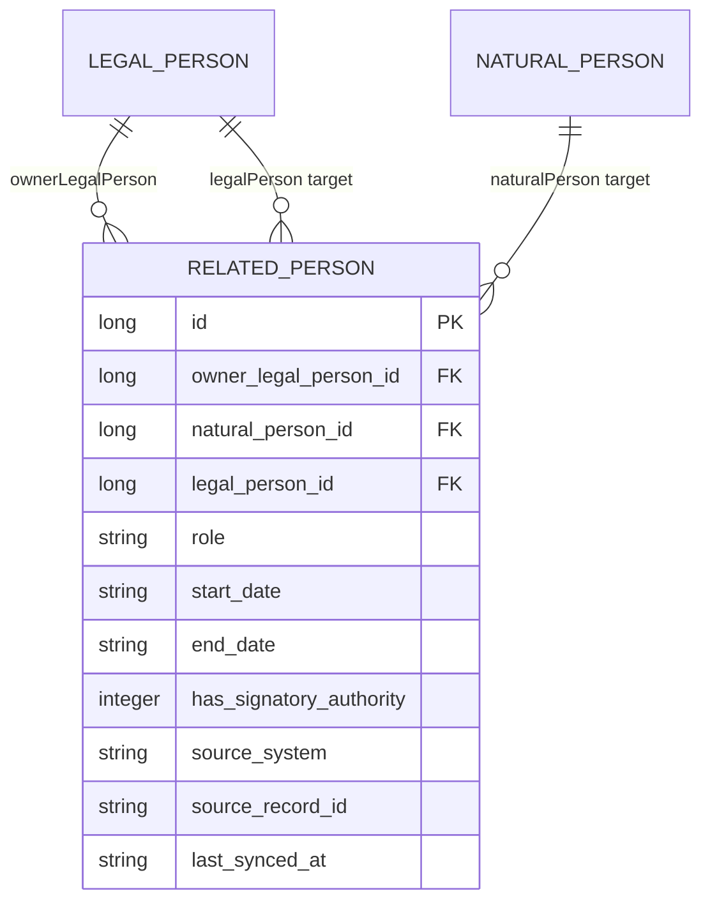

# رابطه اشخاص مرتبط

Last Updated: 2026-07-26

## هدف سند

این سند مدل داده، قواعد دامنه، API و فرایند همگام‌سازی «اشخاص مرتبط» با مودی حقوقی را شرح می‌دهد. پیاده‌سازی فعلی به سامانه ثبت شرکت‌های fake متصل است.

## تعریف رابطه

`RelatedPerson` خودِ شخص نیست؛ یک رابطه زمان‌دار میان یک شخص حقوقیِ مالک و دقیقاً یک شخص حقیقی یا حقوقیِ مرتبط است. بنابراین اطلاعات هویتی در `NaturalPerson` یا `LegalPerson` نگهداری می‌شود و سمت، بازه اعتبار و حق امضا در `RelatedPerson` قرار می‌گیرد.



رابطه به شخص حقوقی مودی تعلق دارد و برای همه برگ‌های اجرای آن مودی قابل استفاده مجدد است. در داده‌های همگام‌شده، `execution_paper_id` عمداً `null` است؛ برگ اجرا فقط زمینه بازیابی و تعیین سال بدهی را فراهم می‌کند.

## قواعد دامنه

هر رابطه باید این شرایط را داشته باشد:

1. `ownerLegalPerson` الزامی است.
2. دقیقاً یکی از `naturalPerson` یا `legalPerson` باید مقدار داشته باشد.
3. `role` الزامی و برای نوع شخص مقصد مجاز باشد.
4. شخص حقیقی باید حداقل `nationalCode` یا `fida` داشته باشد.
5. شخص حقوقی مقصد باید حداقل `nationalId` یا `registrationNumber` داشته باشد.
6. تاریخ‌ها شمسی و با قالب متعارف `yyyy-MM-dd` نگهداری می‌شوند. ورودی ارقام فارسی به انگلیسی و `/` به `-` تبدیل می‌شود.

سه قاعده اول هنگام `persist/update` نیز با callback موجودیت کنترل می‌شوند.

## انواع شخص و سمت‌های مجاز

| کد سمت | عنوان | حقیقی | حقوقی |
|---|---|:---:|:---:|
| `CEO` | مدیرعامل | بله | خیر |
| `BOARD_CHAIR` | رئیس هیئت‌مدیره | بله | خیر |
| `BOARD_VICE_CHAIR` | نایب‌رئیس هیئت‌مدیره | بله | خیر |
| `BOARD_MEMBER` | عضو هیئت‌مدیره | بله | بله |
| `ALTERNATE_BOARD_MEMBER` | عضو علی‌البدل هیئت‌مدیره | بله | بله |
| `MANAGING_PARTNER` | شریک مدیر | بله | خیر |
| `PARTNER` | شریک | بله | بله |
| `SHAREHOLDER` | سهام‌دار | بله | بله |
| `LEGAL_REPRESENTATIVE` | نماینده قانونی | بله | بله |
| `LEGAL_ENTITY_REPRESENTATIVE` | نماینده شخص حقوقی | بله | خیر |
| `LIQUIDATOR` | مدیر تصفیه | بله | بله |
| `PRIMARY_INSPECTOR` | بازرس اصلی | بله | بله |
| `ALTERNATE_INSPECTOR` | بازرس علی‌البدل | بله | بله |
| `PARENT_COMPANY` | شرکت مادر | خیر | بله |
| `SUBSIDIARY` | شرکت تابعه | خیر | بله |
| `AFFILIATE` | شخص حقوقی وابسته | خیر | بله |

کد نوع شخص `NATURAL` برای شخص حقیقی و `LEGAL` برای شخص حقوقی است.

## بازیابی اشخاص مرتبط

```http
GET /api/v1/execution-papers/{id}/related-persons
```

مجوز لازم یکی از `REPORT_VIEW` یا `EXECUTION_PAPER_DETAIL_VIEW` است.

سرویس ابتدا برگ اجرا، مودی، شخص حقوقی مالک و برگ بدهی قطعی را پیدا می‌کند. اگر مودی حقیقی باشد، عملیات با خطای `RELATED_PERSONS_ONLY_FOR_LEGAL_TAXPAYER` متوقف می‌شود.

فقط رابطه‌هایی بازگردانده می‌شوند که بازه اعتبارشان با سال عملکرد برگ بدهی هم‌پوشانی داشته باشد:

```text
(startDate is empty OR startDate <= debtYear-12-30)
AND
(endDate is empty OR endDate >= debtYear-01-01)
```

تاریخ شروع خالی به معنی بدون کران شروع و تاریخ پایان خالی به معنی رابطه جاری است. اگر سال بدهی خالی باشد، همه روابط بازگردانده می‌شوند.

نمونه پاسخ:

```json
{
  "executionPaperId": 100,
  "ownerLegalPersonId": 10,
  "ownerNationalId": "14001234567",
  "debtYear": "1405",
  "lastSyncedAt": "2026-07-26T12:30:00",
  "relatedPersons": [
    {
      "relationshipId": 40,
      "personType": "NATURAL",
      "role": "CEO",
      "roleLabel": "مدیرعامل",
      "startDate": "1400-01-01",
      "endDate": null,
      "hasSignatoryAuthority": true,
      "naturalPersonId": 20,
      "nationalCode": "0012345678",
      "fida": null,
      "firstName": "علی",
      "lastName": "احمدی",
      "fatherName": "محمد",
      "birthDate": "1365-04-12",
      "legalPersonId": null,
      "nationalId": null,
      "registrationNumber": null,
      "registrationDate": null,
      "companyName": null
    }
  ]
}
```

برای مقصد حقوقی، فیلدهای شخص حقیقی `null` و فیلدهای `legalPersonId`، `nationalId`، `registrationNumber`، `registrationDate` و `companyName` مقداردهی می‌شوند.

## همگام‌سازی با ثبت شرکت‌ها

```http
POST /api/v1/execution-papers/{id}/related-persons/refresh
```

مجوز این endpoint نیز یکی از `REPORT_VIEW` یا `EXECUTION_PAPER_DETAIL_VIEW` است.

فرایند همگام‌سازی:

1. شناسه ملی شخص حقوقی مودی از روی برگ اجرا پیدا می‌شود.
2. سرویس `FakeCompanyRegistryService` اشخاص مرتبط را برمی‌گرداند.
3. داده ورودی از نظر نوع شخص، سمت و شناسه هویتی اعتبارسنجی می‌شود.
4. شخص حقیقی با `nationalCode` و در نبود آن با `fida` پیدا یا ایجاد می‌شود.
5. شخص حقوقی با `nationalId` و در نبود آن با `registrationNumber` پیدا یا ایجاد می‌شود.
6. رابطه با کلید `(ownerLegalPersonId, sourceSystem, sourceRecordId)` درج یا به‌روزرسانی می‌شود.
7. پاسخ بر اساس سال بدهی فیلتر می‌شود.
8. رخداد audit با کد `RELATED_PERSONS_REFRESHED_FROM_COMPANY_REGISTRY` و snapshot پاسخ ثبت می‌شود.

مقدار `sourceSystem` در پیاده‌سازی فعلی `FAKE_COMPANY_REGISTRY` است. اجرای چندباره refresh رکورد تکراری برای همان کلید خارجی ایجاد نمی‌کند.

## ساختار داده ورودی integration

| فیلد | شرح |
|---|---|
| `sourceRecordId` | شناسه پایدار رکورد در سامانه مبدأ |
| `personType` | `NATURAL` یا `LEGAL` |
| `role` | کد سمت |
| `startDate`, `endDate` | بازه اعتبار شمسی |
| `hasSignatoryAuthority` | داشتن حق امضا |
| `nationalCode`, `fida` | شناسه‌های شخص حقیقی |
| `firstName`, `lastName`, `fatherName`, `birthDate` | مشخصات شخص حقیقی |
| `nationalId`, `registrationNumber` | شناسه‌های شخص حقوقی |
| `registrationDate`, `companyName` | مشخصات شخص حقوقی |

## خطاهای کسب‌وکاری

| کد | علت |
|---|---|
| `EXECUTION_PAPER_NOT_FOUND` | برگ اجرا وجود ندارد |
| `TAXPAYER_NOT_FOUND` | مودی برگ اجرا وجود ندارد |
| `RELATED_PERSONS_ONLY_FOR_LEGAL_TAXPAYER` | مودی شخص حقوقی نیست |
| `LEGAL_PERSON_NOT_FOUND` | رکورد شخص حقوقی مودی وجود ندارد |
| `FINALIZED_DEBT_PAPER_NOT_FOUND` | برگ بدهی قطعی مرتبط وجود ندارد |
| `LEGAL_PERSON_NATIONAL_ID_REQUIRED` | شناسه ملی مالک برای استعلام موجود نیست |
| `COMPANY_REGISTRY_DATA_INVALID` | نوع شخص یا سمت در ورودی نامعتبر است |
| `RELATED_PERSON_ROLE_NOT_ALLOWED` | سمت برای نوع شخص مقصد مجاز نیست |
| `RELATED_NATURAL_PERSON_IDENTIFIER_REQUIRED` | شناسه شخص حقیقی موجود نیست |
| `RELATED_LEGAL_PERSON_IDENTIFIER_REQUIRED` | شناسه شخص حقوقی موجود نیست |
| `RELATED_PERSON_AUDIT_PAYLOAD_ERROR` | ساخت payload رخداد audit ناموفق است |

## پایگاه داده و قیود

اسکریپت دستی `003_company_registry_related_persons_schema.sql` ستون‌های مالک، سمت و اطلاعات منبع را اضافه می‌کند و این indexها را می‌سازد:

- index روی `owner_legal_person_id`
- unique index روی `(owner_legal_person_id, source_system, source_record_id)`

پروژه فعلاً از Hibernate `ddl-auto=update` استفاده می‌کند و migration رسمی Flyway/Liquibase ندارد.

## محدودیت‌ها و نکات فنی

- integration فعلی fake و deterministic است؛ قرارداد و احراز هویت سامانه واقعی ثبت شرکت‌ها هنوز تعریف نشده است.
- refresh فقط رکوردهای دریافت‌شده را upsert می‌کند و رابطه‌هایی را که دیگر در پاسخ مبدأ نیستند حذف یا منقضی نمی‌کند.
- قیود «مالک الزامی»، «دقیقاً یک مقصد» و «سمت مجاز» در سطح برنامه کنترل می‌شوند و در اسکریپت فعلی database constraint متناظر ندارند.
- مقایسه بازه‌ها رشته‌ای است و به تاریخ‌های صفرگذاری‌شده با قالب `yyyy-MM-dd` وابسته است.
- `lastSyncedAt` به صورت رشته `LocalDateTime` بدون timezone ذخیره می‌شود.
- endpoint همگام‌سازی عملیات تغییردهنده است، اما در حال حاضر مجوز مجزایی برای refresh ندارد.

## فایل‌های مرجع

- `domain/model/execution/RelatedPerson.java`
- `domain/enums/RelatedPersonRole.java`
- `application/service/RelatedPersonService.java`
- `application/service/FakeCompanyRegistryService.java`
- `presentation/api/ExecutionPaperController.java`
- `resources/db/manual/003_company_registry_related_persons_schema.sql`
- `unit/service/RelatedPersonServiceUnitTest.java`
