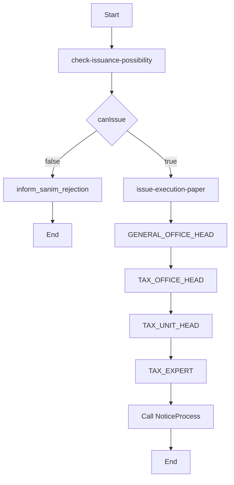

# فرایند برگ اجرا

Last Updated: 2026-07-15

## هدف سند

شرح BPMN `ExecutionPapers.bpmn` برای صدور و گردش سازمانی برگ اجرا.

## مخاطبان

تحلیلگران فرایند، تیم Camunda، توسعه‌دهندگان.

## مشخصات

| مورد | مقدار |
|---|---|
| BPMN file | `src/main/resources/bpmn/ExecutionPapers.bpmn` |
| Process ID | `Process_0rtbdc5` |
| Name | `ExecutionPapers` |
| Start | `Event_1dm1a0h` |
| End | `Event_10ewku3`, `Event_0executionPaperCartableEnd` |

## عناصر مهم

| Element ID | نام | نوع | Actor/Worker | ورودی/خروجی |
|---|---|---|---|---|
| `Activity_1ahtl92` | بررسی امکان صدور برگ اجرا | Service Task | `CheckIssuancePossibilityWorker`, type `check-issuance-possibility-v2` | `debtPaperPayload` -> `canIssue`, rejection vars |
| `Gateway_1uchrac` | تصمیم امکان صدور | Exclusive Gateway | BPMN | `canIssue` |
| `Activity_0rwz3ak` | صدور برگ اجرا با شناسه یکتا | Service Task | `IssueExecutionPaperWorker`, type `issue-execution-paper` | خروجی `executionPaperId`, `executionPaperCode`, org vars |
| `Activity_010iyzn` | ارسال پاسخ عدم امکان صدور | Send Task | `SendRejectionResponseWorker`, type `inform_sanim_rejection` | rejection vars |
| `Activity_0generalHeadReview` | بررسی و ارجاع توسط رئیس اداره کل | User Task | candidate `GENERAL_OFFICE_HEAD:{generalDirectorateId}` | complete/delegate |
| `Activity_0taxOfficeHeadReview` | بررسی و ارجاع توسط رئیس اداره مالیات | User Task | candidate `TAX_OFFICE_HEAD:{taxAffairsOfficeId}` | complete/delegate |
| `Activity_0taxUnitHeadReview` | بررسی و ارجاع توسط رئیس واحد مالیاتی | User Task | candidate `TAX_UNIT_HEAD:{taxUnitId}` | complete/delegate |
| `Activity_0taxExpertProcess` | رسیدگی توسط کارشناس مالیاتی | User Task | candidate `TAX_EXPERT:{taxUnitId}` | complete |
| `Activity_0xodqlk` | ابلاغ برگ اجرا | Call Activity | `Process_0lt64q4` | propagate child variables |

## نمای Mermaid

## نقش‌ها و assignment

نقش‌ها در BPMN به صورت candidateGroups وابسته به شناسه سازمان تعریف شده‌اند. برای نمونه برگ اجرای متعلق به اداره کل تهران فقط در گروهی مانند `GENERAL_OFFICE_HEAD:700` قرار می‌گیرد. backend همان گروه سازمانی را از نقش و محل سازمانی پروفایل کاربر در `CamundaIdentityMappingService.toCamundaCandidateGroups` تولید می‌کند و `TaskAuthorizationService` نیز محدوده را دوباره کنترل می‌کند.

## ریسک‌ها

- retry در `zeebe:taskDefinition` برای برخی service taskها خالی است.
- process instances قدیمی ممکن است متغیرهای سازمانی نادرست/ناقص داشته باشند.

## اسناد مرتبط

- [فرایند ابلاغ](inform-process.md)
- [معماری گردش‌کار](../../architecture/workflow-architecture.md)

## سوالات باز

- فرم یا تصمیم نهایی کارشناس مالیاتی در BPMN دقیقاً چه داده‌ای باید تولید کند؟
