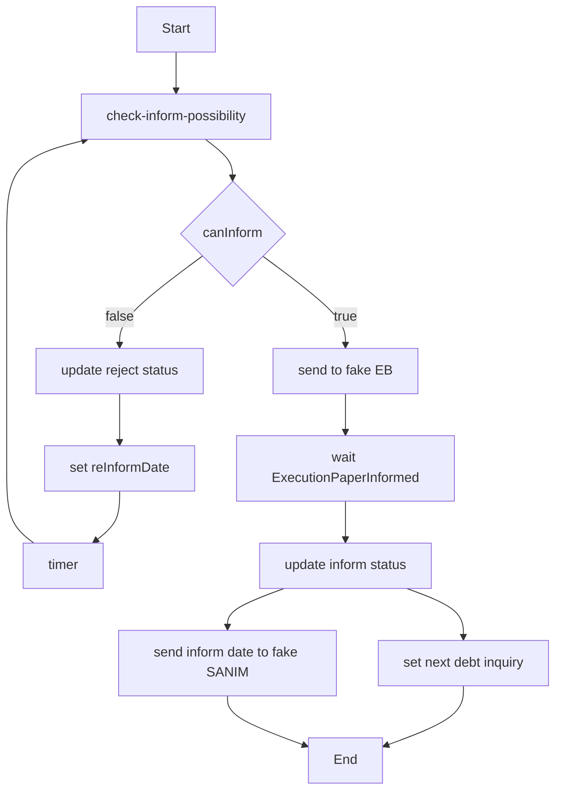

# فرایند ابلاغ

Last Updated: 2026-07-15

## هدف سند

شرح BPMN `Inform.bpmn` برای بررسی امکان ابلاغ، ارسال به سامانه ابلاغ، دریافت تاریخ ابلاغ و ارسال به سنیم.

## مخاطبان

تیم workflow، integration و تحلیلگران کسب‌وکار.

## مشخصات

| مورد | مقدار |
|---|---|
| BPMN file | `src/main/resources/bpmn/Inform.bpmn` |
| Process ID | `Process_0lt64q4` |
| Name | `NoticeProcess` |
| Message | `ExecutionPaperInformed` |

## عناصر مهم

| Element ID | نام | نوع | Worker/Actor | توضیح |
|---|---|---|---|---|
| `Activity_0mt4vh9` | بررسی امکان ابلاغ | Service Task | `CheckInformPossibilityWorker`, type `check-inform-possibility` | rule engine ابلاغ |
| `Gateway_1xlhqz9` | تصمیم امکان ابلاغ | Exclusive Gateway | BPMN | `canInform` |
| `Activity_1ph17fo` | بروزرسانی وضعیت رد ابلاغ | Service Task | `UpdateInformStatusWorker` | rejection reason و زمان |
| `Activity_0coidwa` | تنظیم ابلاغ مجدد | Service Task | `SetReInformDateWorker` | خروجی `reInformDate` |
| `Event_0ijgi1v` | فرارسیدن تاریخ رفع محدودیت | Timer Event | BPMN | انتظار تا `reInformDate` |
| `Activity_1wj000f` | ارسال به سامانه ابلاغ | Send Task | `SendExecutionPaperToElectronicNotificationWorker` | fake service |
| `Event_05e6j5b` | دریافت تاریخ ابلاغ | Message Catch | `ExecutionPaperInformed` | توسط callback منتشر می‌شود |
| `Activity_18aw0is` | بروزرسانی وضعیت ابلاغ | Service Task | `UpdateInformStatusWorker` | ثبت `InformDate` |
| `Activity_131cbua` | تنظیم تاریخ استعلام بدهی | Service Task | `SetDebtInquiryDateWorker` | `nextDebtInquiryDate` |
| `Activity_077bco2` | ارسال تاریخ ابلاغ به سنیم | Send Task | `SendInformDataToSanimWorker` | fake SANIM |

## Mermaid

## اسناد مرتبط

- [فرایند برگ اجرا](execution-paper-process.md)
- [یکپارچه‌سازی‌ها](../../technical/integrations.md)

## سوالات باز

- قرارداد message correlation برای سامانه ابلاغ واقعی باید نهایی شود.

